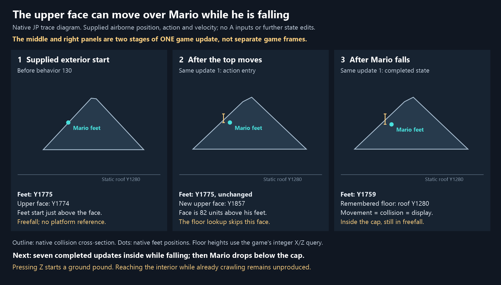

# Direct tests of entering the spinning top

Follow-up: the [fixed airborne-entry-to-crawl test](ink-air-entry-to-crawl.md)
tries controller-only conversion after this entry. It finds no interior
crouch or crawl in the tested menus; delayed ground pound extends residence
to20 game frames. The follow-up also clarifies that an update here is a
game-logic frame and that this entry has already missed the original
behavior130 crawling split.

**The moving upper face can put Mario inside the top from an exterior
position. The reproduced direct entry is airborne, not crawling.** Separate
tests start with a verified, top-supported crawler, lose the upper floor,
and later enter the cap through its motion. In the retained deep-entry
example, Mario changes to sliding and then falling before the cap catches
him. No tested continuation preserves crawling into the required deep
interior position. The clean high-crawl entry remains open.

These are supplied-start native JP experiments. They test the missing local
mechanism directly; they do not demonstrate an ordinary-play approach to
their starting positions. They use no box placement or box transport search.
The earlier remote three-pillar and four-pillar approaches are not evidence
for these local tests.

## What was supplied

Each test replays the accepted 2,548-input four-pillar history and waits for
the selected spinning phase. The startup uses the existing debug level
select before gameplay. The four pillars, top motion, collision surfaces,
actor histories and timing after entry are produced by the native runtime.

At one declared starting boundary, the experiment supplies Mario's movement,
object/collision and display positions; action, action state and action
timer; forward speed, velocity and facing angles. The receipt contains the
before/after value of every supplied write. The crawling trials supply
`ACT_CRAWLING`; airborne trials supply `ACT_FREEFALL`, including downward
velocity −16. None of these placements is claimed to have been reached by
the preceding controller history.

The floor cache, platform reference, hitbox size, top, timers, RNG, actors
and collision surfaces are **not written**. Crawling trials must first pass
one native preparation update ending in crawl, with a 100-unit hitbox,
top-owned floor, top platform reference and feet on that floor. Seeds that
fail any of those conditions are rejected. Thus the accepted crawl tests
start from native-confirmed support, not an assumed platform pointer.

After the declared setup, a write guard allows only controller-pad fields.
Every input has A off; the native A-pressed and A-held input flags are also
checked after each update. Restoring a complete saved state starts a new
trial; it does not splice edits into a running trial.

## Positive result: enter through the upper face while airborne



The selected start is `(-2261.5, 1774.9970703125, -1048)`, immediately before
behavior 130. Mario is in supplied freefall with forward speed 0 and vertical
velocity−16, and has no platform reference. At this point his feet are
**one unit above** the upper-face floor-query height, Y1773.9970703125. At
Mario's unrounded X/Z, an independent calculation from the triangle
vertices puts the face at 1773.5, giving 1.497 units of actual clearance.
The supplied feet are outside the cap, not already inside it.

| Moment | Mario's feet Y | Upper-face floor-query Y | What happens |
| --- | ---: | ---: | --- |
| Supplied boundary before update 1 | 1774.997 | 1773.997 | Freefall, just above the face; no platform |
| Update1 / behavior 130, action-entry event | 1774.997 | 1857.187 | The new face is 82.190 units above his feet; Mario has not yet taken his falling step |
| Same update 1, completed boundary | 1758.997 | 1857.187 | Native freefall; remembered floor 1280; movement, collision and display positions agree |
| Completed update 2 / behavior 131 | 1738.997 | 1873.765 | Still falling inside; the underside is 1528 |
| Completed update 7 / behavior 136 | 1578.997 | 1882.596 | Still inside; underside 1553 |
| Completed update 8 / behavior 137 | 1534.997 | 1813.500 | Feet have fallen below the underside 1558 |

The two update 1 rows are **stages within one game update**, not two game
frames. The native action log supplies the action-entry position and
action. The upper-face heights and interior labels are calculations from
that update's recorded native collision vertices and planes. The completed
boundary supplies floor 1280 and the three position records directly.

Why this works: the game prepares the top's moved/rotated collision before
Mario runs. With no platform reference, this airborne Mario is not carried
around with the top. The local upper face rises83.190 units at his unchanged
X/Z. A floor query rejects a face more than78 units above its integer query
Y. Here the new face is 83.187 units above `int(1774.997)`, beyond that
allowance. The cap's faces do not enforce an impenetrable solid volume, so
Mario can remain inside and fall through. This explanation combines native
observations with the source query rule; it is not a separate simulated
physics update.

Mario remains inside at seven consecutive completed boundaries, then falls
through the bottom and lands on roof 1280 at update 13. This is a real local
entry mechanism from the supplied exterior start, but it creates no Ink
gap at entry: M=C=D at the end of update 1. It also remembers roof 1280, not
the low pad 768, and its X/Z differs from the recorded handoff.

Pressing Z on update 2 produces `ACT_GROUND_POUND`, not crawl. Both the
fixed-heading Z continuation and the inward-steering Z continuation were
run and freshly replayed; neither establishes interior crawling. This is
a finite continuation check, not an exclusion of every way to change action.

## Direct test of crawling off an edge and being caught

The retained example supplies crawl on an upper face near its edge before
behavior 92, at `(-1776.21875, 1359.407470703125, -584.71875)` with forward
speed 16. One native preparation update produces actual supported crawl at
Y1387.7452392578125, with the top as both floor and platform. Its controller
continuation holds Z, steers outward for three updates, then inward.

| Update after preparation | Recorded result |
| --- | --- |
| 1–10 | Crawling on the top; shallow action-entry overlaps are corrected to its upper floor |
| 11 | Changes to stomach slide while still supported by the top |
| 15 | Loses the top floor and platform, changes to freefall; feetY1427.285 |
| 16 | Still outside the cap's footprint and falling |
| 17 | The cap moves around him: action-entry depth 120.583, completed depth 124.583; feetY1423.285, upper faceY1547.867, underside 1418 |
| 18 | Outside the footprint again |
| 19 | Recaptured on the upper face, entering freefall landing at Y1470.248 |

Thus edge loss followed by rotation-induced interior entry **does happen**
in this supplied-start test. Crawling has already ended before the deep
entry. Another retained example loses the top floor while still crawling,
but snaps onto static terrain aroundY1265, below the cap; it later slides
away. Losing the top floor while crawling and entering the cap while
falling are separate observations, not a combined successful crawler entry.

## Coverage and limits

| Batch | Supplied seeds | Accepted supported crawlers | Continuations | Native suffix updates | Deep interior while crawling |
| --- | ---: | ---: | ---: | ---: | ---: |
| Near the four base edges | 1,965 | 581 | 3,486 | 73,404 | 0 |
| Higher on all four upper faces | 3,300 | 2,533 | 15,198 | 310,212 | 0 |
| Supplied exterior freefall / B-dive | 8,640 | Not a crawl test | 17,280 | 371,520 | Not a crawl test |

The two crawler batches total18,684 continuations and 383,616 suffix
updates, starting from 3,114 accepted supported crawlers. They sample stored
phases60,76,92,108,120,124,128,129,130,140,148; five locations along each
face's base edge; eight total edge-to-apex fractions; supplied speeds0,4,16;
and six steering policies. Runs last up to24 updates, stopping when the top
deactivates or the area changes. There are752 crawler-start continuations
with deep interior at a completed boundary in another action, and none
with a completed interior crawler. This does not cover every stick value,
heading, speed, phase, prior history or collision interaction.

The separate air batch samples six phases, all four faces, heights1 and 80
above the face, four headings, speeds0/32/64, and falling versus a first-input
B dive. A focused first-update rerun of the 8,640 falling starts finds 130
cases deep inside both at action entry and at the completed boundary. The
selected behavior 130 example above is one of them. Its supplied vertical
and horizontal state, and the absence of a prior platform, remain explicit.

“Deep interior” here means feet above the cap underside and below an upper
face that is beyond the floor query's78-unit allowance. This is a diagnostic
for the useful kind of overlap, not the complete handoff condition. The
receipt separately records shallow overlap, native action, floor ownership
and platform. It does not turn every body overlap or every high floor
reference into a successful entry or platform attachment.

## Verification and evidence

The [receipt](ink-crawl-edge-entry-receipt.json) includes batch counts,
supplied-edit ledgers, hashes, native action logs, selected controls and
full native top meshes for the detailed witnesses. Ten distinct selected
batch histories were freshly replayed. The detailed edge and direct-face
trails were replayed again with meshes and collision positions included;
the three direct-face continuations add three distinct histories. All
recorded selected comparisons passed:13 distinct histories,313 compared
updates with repeated category witnesses counted once. These are native JP runtime tests,
not new original-ROM emulator recordings or whole-memory equivalence checks.

The pinned runtime SHA256 is
`960fe979068b78e6733b3ddb87741833fbf4eb29b2a21a2bba871977427c2d0f`.
The accepted input capture SHA256 is
`9bcc451964025d9f0bb1344c45957b6bfd095451b44bfb9a01f8584a75db6a72`.
Full batch JSON files remain under `build/wafel-pilot/`; their hashes are
retained in the receipt. The initial edge/air batches used the archived
`ink_crawl_edge_entry-v1.py`; the current version adds the upper-face sampling
option without changing the default policies. The witness recorder hashes
its current dependencies.

Reproduce from the SSL project directory with its bundled Wafel Python:

```powershell
& ./build/wafel-pilot/python/python.exe instrumentation/wafel-jp-pilot/ink_crawl_edge_entry.py build/wafel-pilot/new-edge.json
& ./build/wafel-pilot/python/python.exe instrumentation/wafel-jp-pilot/ink_crawl_edge_entry.py build/wafel-pilot/new-upper.json --surface upper
& ./build/wafel-pilot/python/python.exe instrumentation/wafel-jp-pilot/ink_crawl_edge_entry.py build/wafel-pilot/new-air.json --mode air
& ./build/wafel-pilot/python/python.exe instrumentation/wafel-jp-pilot/ink_top_entry_witnesses.py build/wafel-pilot/new-witnesses.json --edge-batch build/wafel-pilot/new-edge.json
```

Source connections: `src/game/object_list_processor.c` prepares dynamic
surfaces and platform displacement before Mario; `platform_displacement.c`
applies the prior platform's transform; `mario.c:update_mario_geometry_inputs`
refreshes the floor; `surface_collision.c:find_floor_from_list` applies the
78-unit cutoff; `mario_actions_moving.c:act_crawling` can switch to sliding or
freefall; `mario_step.c` handles ground/air quarter steps. These explanatory
source references belong to `reference-sm64-decomp` and are not new formal
proofs about the execution.

The latest inspected proof commit is
`e8b1b8d1ef8ead32810172237658a353b8fb52b4`, newer than the original handoff
commit. Its conditional fresh-floor/push/crawl connections and reverse
sampler do not supply a clean interior-crawl predecessor. This investigation
changes no Coq theorem or capstone assumption. All 45 atlas estimates remain
unchanged, including Rank 1 **1–2%** and Ink Rank 2 **<1%**. The local report and
private-site report retain the same verdict.
