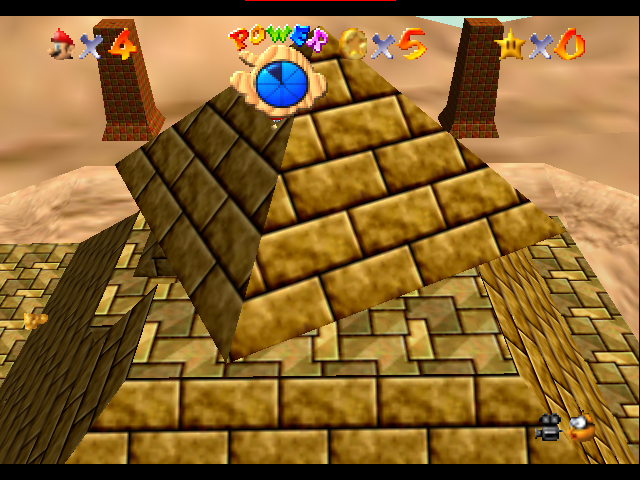
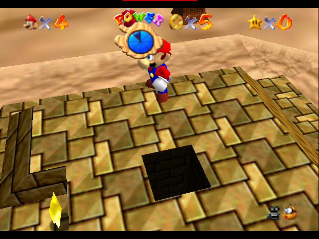
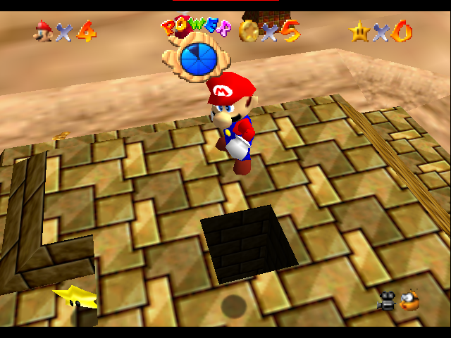
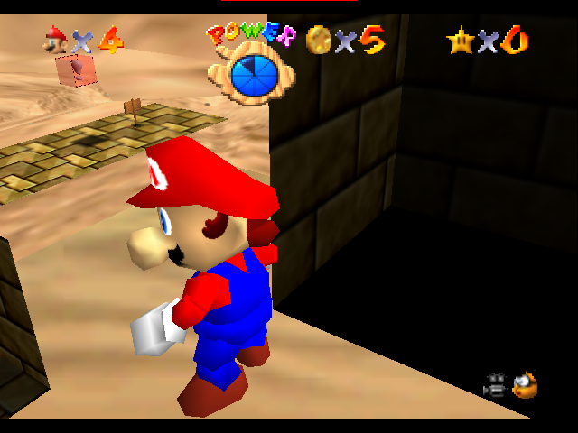

# Where the 973-unit candidates sit

These are native screenshots from the authenticated original Japanese ROM,
captured on 11 November 2026. Mario's **graphics position and camera are
supplied for illustration**. They are not photographs of a controller-produced
state or a second runtime test of the shell handoff. Physical movement,
collision, action and floor cache remain at the ordinary prefix state.

The [handoff analysis](ink-timer130-handoff.md) and
[separate Wafel experiment](ink-timer130-crawl-replay.md) explain the physical
mechanism and its remaining conditions.

## Timer130 views

The normal rendering hides Mario inside the solid moving top at the pushed
high position `(-1882,1741,-939)`:



For the next two images **only the spinning top's render node is hidden**.
Its collision geometry is not removed. The camera is closer so the two
positions can be compared against the opening in the static roof.

High pad query position, `(-1950,1741,-939)`. The Y=768 pad lies below Mario;
Mario is not shown standing on a floor at1741:



After the proposed 68-unit push, `(-1882,1741,-939)`:



Low target, `(-1882,768,-939)`, using a camera inside/below the roof so the
shaft wall does not hide Mario:



The warp object itself has no visible model. Its center is
`(-2048,768,-1024)`: the low target is166 units in +X and85 in +Z from it,
at the same height. The horizontal distance is about186.497, just inside
the stock combined warp/Mario radius187. These distance calculations do
not alone guarantee interaction acceptance.

## Both phases and all original images

| Position | Normal130 | Cutaway130 | Normal131 | Cutaway131 |
| --- | --- | --- | --- | --- |
| High pad `(-1950,1741,-939)` | [PNG](../media/ink-timer130-views/normal-high-pad-130.png) | [PNG](../media/ink-timer130-views/cutaway-high-pad-130.png) | [PNG](../media/ink-timer130-views/normal-high-pad-131.png) | [PNG](../media/ink-timer130-views/cutaway-high-pad-131.png) |
| Pushed high `(-1882,1741,-939)` | [PNG](../media/ink-timer130-views/normal-pushed-high-130.png) | [PNG](../media/ink-timer130-views/cutaway-pushed-high-130.png) | [PNG](../media/ink-timer130-views/normal-pushed-high-131.png) | [PNG](../media/ink-timer130-views/cutaway-pushed-high-131.png) |
| Low target `(-1882,768,-939)` | [PNG](../media/ink-timer130-views/normal-low-target-130.png) | [PNG](../media/ink-timer130-views/cutaway-low-target-130.png) | [PNG](../media/ink-timer130-views/normal-low-target-131.png) | [PNG](../media/ink-timer130-views/cutaway-low-target-131.png) |

## What the renderer changes and how the images were checked

The [capture helper](../../instrumentation/jp-ink-candidate-views/README.md)
uses the existing four-pillar controller prefix. It records the native top
graphics transforms immediately after behavior phases130 and131, when the
stored object counters are131 and132. Later pictures reuse those snapshots;
their pictured phase is not the later physical object's current counter.

At the camera-render callback, it temporarily substitutes Mario's graphics
XYZ, the top's saved graphics transform and the camera's position/focus. It
clears the two graphics `throwMatrix` pointers for that render. Cutaway mode
also hides the top's render node. All edits are restored before the next
controller poll. No action/cache/collision data is edited and no controller
reachability follows. The normal camera is `(-500,2450,-1000)`, looking at
`(-2048,1350,-1024)`. Cutaway high views use `(-1450,2150,-800)`, looking at
`(-1950,1650,-939)`; low views use `(-1700,1000,-1100)`, looking at
`(-1940,850,-939)`.

The first exploratory capture revealed one-frame Rice screenshot latency.
The final runs hold each scene for three renders and request its screenshot
only on the third. The preceding completed framebuffer has the same supplied
pose, phase and camera. The checker verifies18 held-render records, six
requests, exact coordinate/phase mapping, screenshot frame numbers and image
hashes. The seventh image at frame2700 is a stop marker and is excluded.
Both final inventories pass; all12 copied PNG hashes match. No image pixels
were painted, generated or retouched.

The [manifest](../media/ink-timer130-views/manifest.json) records every image
hash, original filename, phase, coordinate, hidden-top flag, raw-log hash,
probe-binary hash and helper-source hashes. The
[normal trace](../media/ink-timer130-views/normal-trace.txt) and
[cutaway trace](../media/ink-timer130-views/cutaway-trace.txt) retain the render
records. The full raw captures remain under workspace `build/`.

From the workspace root in Ubuntu-24.04, the final capture commands were:

```sh
bash reference-sm64-wmotr-abc-proof/SSL-Coq/less-than-one-a-press/instrumentation/jp-ink-candidate-views/run.sh \
  reference-sm64-decomp/baserom.jp.z64 build/ink-candidate-views-20261111-held
bash reference-sm64-wmotr-abc-proof/SSL-Coq/less-than-one-a-press/instrumentation/jp-ink-candidate-views/run.sh \
  reference-sm64-decomp/baserom.jp.z64 build/ink-candidate-cutaway-20261111-held cutaway
```

Both runs completed. Read-only validation was repeated against both existing
raw logs with `instrumentation/jp-ink-candidate-views/check.py CAPTURE_DIRECTORY`;
both exited0. The ROM is SHA256
`9cf7a80db321b07a8d461fe536c02c87b7412433953891cdec9191bfad2db317`.
Only screenshots, traces and metadata are included here, not ROM bytes.
